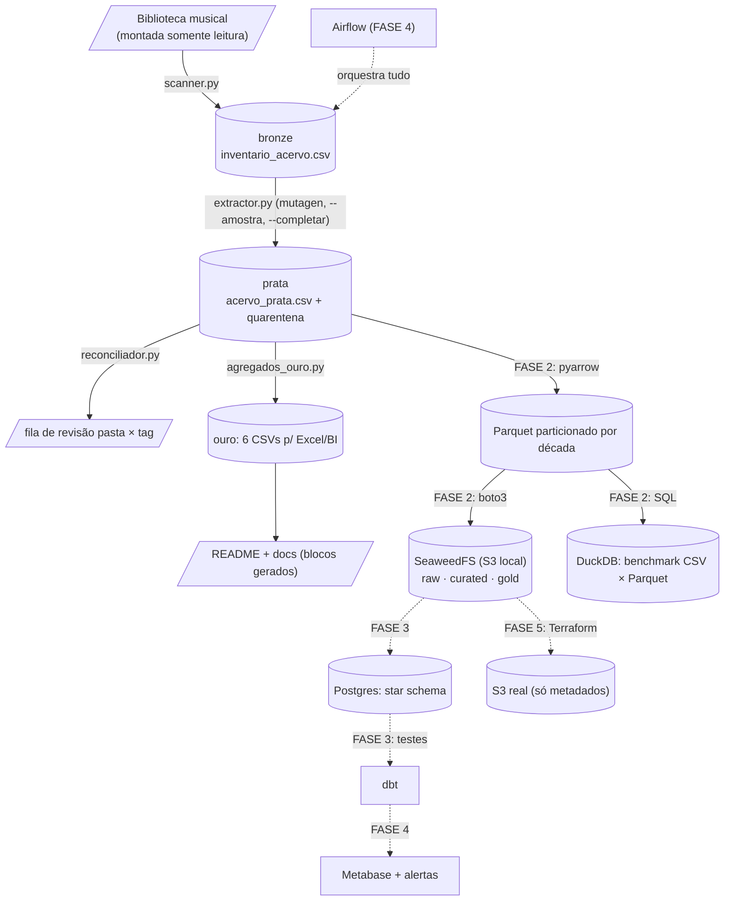

# Acervo Musical — Engenharia de Dados

Pipeline de dados sobre uma biblioteca musical pessoal:
**111k+ faixas | ~920 GB | ~314 dias de áudio** (números exatos e datados na seção Números).

## O que é

Projeto de engenharia de dados que trata uma coleção pessoal de
110k+ arquivos de áudio (MP3/M4A/FLAC) como um produto de dados:
da varredura do disco até resumos prontos para BI, com qualidade
de dados, documentação viva e decisões registradas como ADRs.

## Arquitetura atual (medallion)

```text
    $MUSIC_LIBRARY_PATH --scan-->  bronze  (inventario_acervo.csv)
    bronze --mutagen-->            prata   (acervo_prata.csv + quarentena)
    prata --agregados-->           ouro    (CSVs p/ Excel/BI + evolução)
```

O caminho real da biblioteca fica apenas no `.env` (fora do Git);
docs públicas referenciam a variável, nunca o disco.

- `src/ingest/scanner.py` — foto do disco (somente leitura), capas/scans
- `src/ingest/extractor.py` — tags (ID3/MP4/Vorbis), `--amostra`, `--completar`, quarentena
- `src/ingest/reconciliador.py` — taxonomia pasta × tag (99,6% de concordância)
- `src/transform/agregados_ouro.py` — resumos, snapshot de storage e docs geradas
- `src/transform/csv_para_parquet.py` — Parquet particionado por década + upload S3
- `src/transform/consultas_duckdb.py` — SQL analítico no lake

## Mapa do projeto



Setas cheias = existe hoje; setas pontilhadas = roadmap.

## Números

<!-- NUMEROS-AUTO (gerado por agregados_ouro.py; nao editar na mao) -->
**112,102 faixas | 922.79 GB | 315.4 dias de áudio** *(snapshot de 15/10/2026 23:10)*

- MP3: 67,642 faixas | 636.46 GB | 69.0% do peso
- M4A: 44,160 faixas | 281.06 GB | 30.5% do peso
- FLAC: 300 faixas | 5.27 GB | 0.6% do peso
- Cobertura em FLAC: Subgenre 100.0% | Album Type 100.0%
- Cobertura em M4A: Subgenre 100.0% | Album Type 100.0%
- Cobertura em MP3: Subgenre 100.0% | Album Type 100.0%
- Reconciliação pasta × tag: 99.6% (fila de revisão: 410 casos, ADR-002)
<!-- /NUMEROS-AUTO -->


## Lago de dados (FASE 2)

Zonas no lake S3 local (SeaweedFS, ADR-006), bucket `acervo-musical`:

- `raw/` — CSV da prata como chegou (imutável, reprocessável)
- `curated/` — Parquet particionado por década (hive)
- `gold/` — agregados modelados (FASE 3, dbt)

### Benchmark CSV × Parquet (acervo real, 112.102 faixas)

| Métrica | CSV | Parquet | Ganho |
|---|---|---|---|
| Tamanho | <mb_csv do print> MB | <mb_parquet do print> MB | **<ganho>x menor** |
| Leitura completa (pyarrow) | <t_csv>s | <t_parquet>s | CSV vence (overhead fixo em escala pequena) |
| Query analítica (DuckDB) | <q_csv>s | <q_parquet>s | **<q_ganho>x mais rápido** |

Honestidade de escala: com 43 MB tudo cabe em memória e o overhead
fixo de abrir 8 partições domina a leitura completa; o ganho colunar
aparece onde importa (query que lê só as colunas que precisa) e
cresce com o volume — em TB, a leitura completa também vira.

## Qualidade

- Porteiro local: pre-commit (ruff + gitleaks) em todo commit
- Robô na nuvem: GitHub Actions (pytest + ruff + mypy + pip-audit + gitleaks)
- Vigia: Dependabot semanal (pip + actions)
- 12 testes unitários de hierarquia e derivados
- Type hints validados por mypy em todo o código

## Docs vivas

`docs/hierarquia.md` · `docs/dicionario_de_dados.md` · `docs/glossario.md` ·
`docs/stack.md` · `docs/adr.md` (ADR-003 em diante; ADR-001/002 na hierarquia)

Regra da casa: docs derivadas de dados são geradas (blocos NUMEROS-AUTO /
COLUNAS-AUTO); prosa e decisões são humanas. O gerador só toca entre
marcadores HTML.

## Roadmap

FASE 1 testes/CI → FASE 2 Parquet/SeaweedFS/DuckDB (MinIO teve EOL, ADR-006) →
FASE 3 Postgres/dbt → FASE 4 Airflow/observabilidade → FASE 5 AWS/Terraform

## Como rodar

```text
python -m venv .venv
pip install -r requirements.txt -r requirements-dev.txt
copy .env.example .env   (preencha MUSIC_LIBRARY_PATH)
pre-commit install

python src\ingest\scanner.py
python src\ingest\extractor.py
python src\ingest\reconciliador.py
python src\transform\agregados_ouro.py

# lake local (janela dedicada; ADR-006):
C:\seaweed\weed.exe --% server -dir=C:\seaweed\data -s3 -ip=127.0.0.1 -ip.bind=127.0.0.1 -master.telemetry=false
python src\transform\csv_para_parquet.py
python src\transform\consultas_duckdb.py
```

## Segurança

- Segredos apenas em `.env` (fora do Git); `.env.example` é o molde público
- Biblioteca montada como somente leitura; nenhum arquivo de áudio sobe
  para o repositório
- Lake local escuta apenas em 127.0.0.1 (ADR-006); sem IAM/criptografia
  por ser treino local com dados regeneráveis — o S3 real (Fase 5) traz ambos