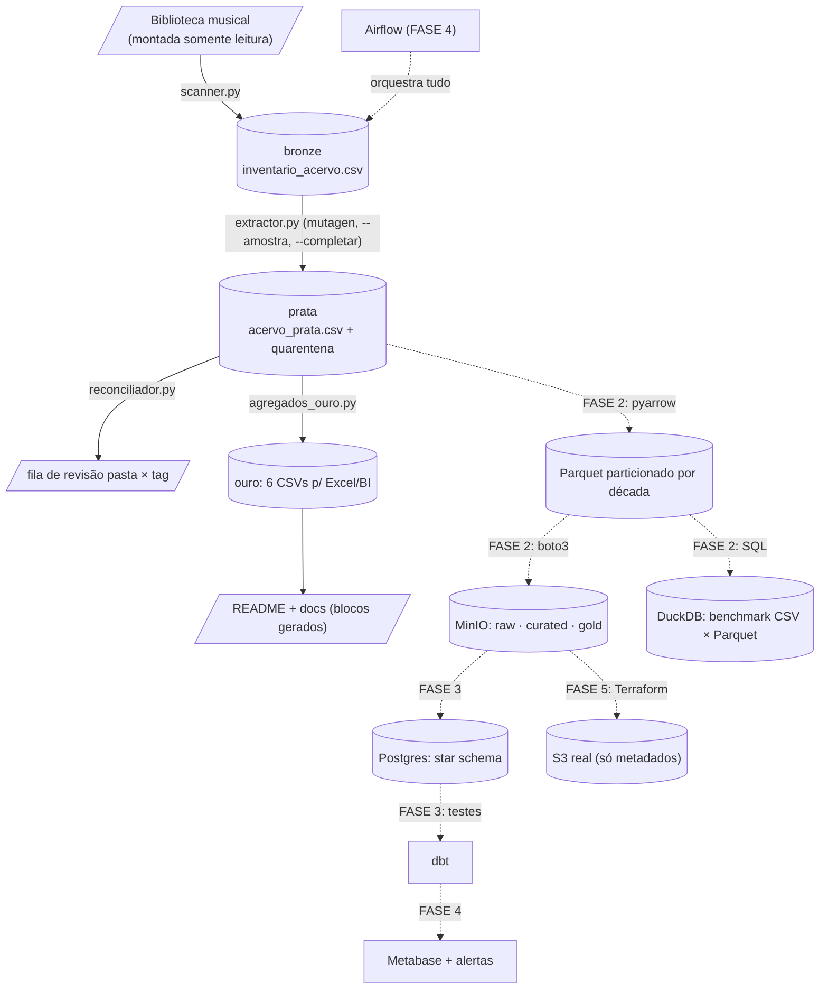

# Acervo Musical — Engenharia de Dados

Pipeline de dados sobre uma biblioteca musical pessoal:
**111k+ faixas | ~920 GB | ~314 dias de áudio** (números exatos e datados na seção Números).

## O que é
Projeto de engenharia de dados que trata uma coleção pessoal de
110k+ arquivos de áudio (MP3/M4A/FLAC) como um produto de dados:
da varredura do disco até resumos prontos para BI, com qualidade
de dados, documentação viva e decisões registradas como ADRs.

## Arquitetura atual (medallion)

    $MUSIC_LIBRARY_PATH --scan-->  bronze  (inventario_acervo.csv)
    bronze --mutagen-->            prata   (acervo_prata.csv + quarentena)
    prata --agregados-->           ouro    (CSVs p/ Excel/BI + evolução)

O caminho real da biblioteca fica apenas no `.env` (fora do Git);
docs públicas referenciam a variável, nunca o disco.

- `src/ingest/scanner.py` — foto do disco (somente leitura), capas/scans
- `src/ingest/extractor.py` — tags (ID3/MP4/Vorbis), `--amostra`, `--completar`, quarentena
- `src/ingest/reconciliador.py` — taxonomia pasta × tag (99,6% de concordância)
- `src/transform/agregados_ouro.py` — resumos e snapshot de storage

## Mapa do projeto

## Números
<!-- NUMEROS-AUTO (gerado por agregados_ouro.py; nao editar na mao) -->
**111,614 faixas | 919.85 GB | 314.1 dias de áudio** *(snapshot de 14/10/2026 19:59)*

- MP3: 67,630 faixas | 636.34 GB | 69.2% do peso
- M4A: 43,684 faixas | 278.25 GB | 30.2% do peso
- FLAC: 300 faixas | 5.27 GB | 0.6% do peso
- Cobertura em FLAC: Subgenre 100.0% | Album Type 100.0%
- Cobertura em M4A: Subgenre 100.0% | Album Type 100.0%
- Cobertura em MP3: Subgenre 100.0% | Album Type 100.0%
- Reconciliação pasta × tag: 99.6% (fila de revisão: 410 casos, ADR-002)
<!-- /NUMEROS-AUTO -->

## Qualidade
- Porteiro local: pre-commit (ruff + gitleaks) em todo commit
- Robô na nuvem: GitHub Actions (pytest + ruff + mypy + pip-audit + gitleaks)
- Vigia: Dependabot semanal (pip + actions)
- 12 testes unitários de hierarquia e derivados
- Type hints validados por mypy em todo o código

## Docs vivas
`docs/hierarquia.md` · `docs/dicionario_de_dados.md` · `docs/glossario.md` ·
`docs/stack.md` · ADRs dentro da hierarquia

## Roadmap
FASE 1 testes/CI → FASE 2 Parquet/MinIO/DuckDB → FASE 3 Postgres/dbt →
FASE 4 Airflow/observabilidade → FASE 5 AWS/Terraform

## Como rodar
    python -m venv .venv
    pip install -r requirements.txt
    copy .env.example .env   (preencha MUSIC_LIBRARY_PATH)
    python src\ingest\scanner.py
    python src\ingest\extractor.py
    python src\transform\agregados_ouro.py

## Segurança
Segredos apenas em `.env` (fora do Git); biblioteca montada como
somente leitura; nenhum arquivo de áudio sobe para o repositório.